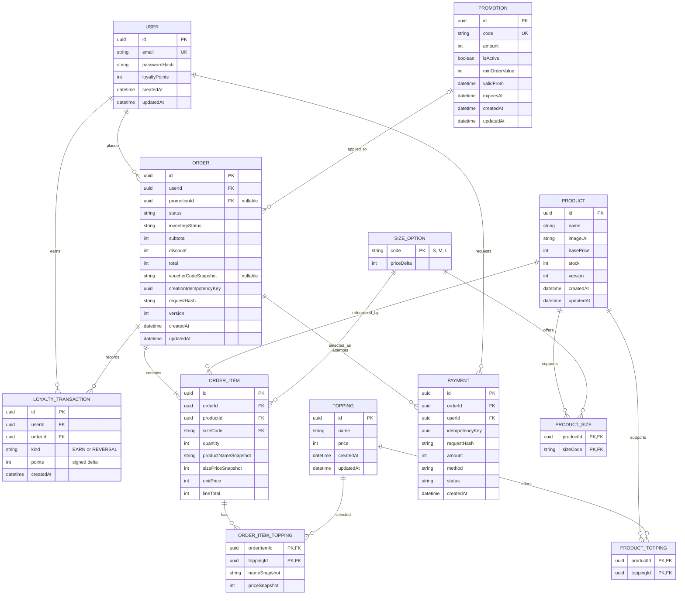
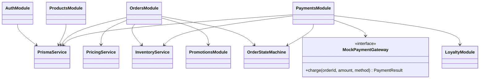

# BrewLite — ERD và sơ đồ module đề xuất

**Tác giả bản gốc:** Đức Phúc (TV6). **Hợp nhất:** 15/10/2026.
**Nguồn chuẩn:** [SRS](../requirements/srs.md), [UC-01](../requirements/use-case-checkout.md).
**Trạng thái:** Bản nháp hòa giải; chưa render bằng công cụ hoặc được nhóm review. ERD/module không thay class nghiệp vụ.

Mermaid giữ thiết kế hữu ích của bản gốc. Dùng chung [use case](use-cases.puml) và [state machine](order-states.puml), không sao chép thành hai bản.

## 1. ERD đề xuất

### Ràng buộc đề xuất

- Bản 10 bảng được mở rộng thành 12 để biểu diễn size/topping hợp lệ theo sản phẩm. Đây là đề xuất, chưa có schema/migration được kiểm chứng. Voucher chuẩn hóa thành Promotion; request vẫn dùng voucherCode theo SRS.
- Unique: User.email, Promotion.code, (Order.userId, creationIdempotencyKey), (Payment.userId, idempotencyKey), (LoyaltyTransaction.orderId, kind). Hai bảng order/payment tách phạm vi phép toán.
- LoyaltyTransaction.kind là EARN hoặc REVERSAL; mỗi loại tối đa một lần/đơn. EARN không âm, REVERSAL là số đối của EARN đã lưu. Giữ cả hai kể cả điểm bằng 0; User.loyaltyPoints không âm, bút toán bù được âm.
- Check stock >= 0, quantity > 0, Payment.amount > 0, discount >= 0 và total = subtotal - discount > 0. Backend kiểm tra size/topping thuộc sản phẩm và Payment.amount = Order.total.
- Partial unique: tối đa một Payment PROCESSING và một SUCCEEDED/đơn. Khóa/cập nhật Order.version tuần tự hóa payment/hủy/retry; tìm key trước ghi không tự bảo đảm chống trùng đồng thời.
- Payment.status đề xuất PROCESSING/SUCCEEDED/FAILED/REFUNDED. Hủy PAID giữ Payment, chuyển REFUNDED cho hoàn mock, không gọi cổng hoàn tiền thật; Order đã CANCELLED không được thanh toán lại.
- Reserve từ RELEASED sang RESERVED cùng tăng version sau kiểm tra stock/version. Release chỉ từ RESERVED; retry tạo chu kỳ giữ kho mới. Hủy PAID cho phép COMMITTED → RELEASED cùng hoàn mock/bù điểm. Trạng thái/version của Order chặn hủy/release lặp.
- Không cascade-delete lịch sử. isAvailable tính từ stock > 0. Không có expiry của Order; Promotion.expiresAt là hạn mã giảm và vẫn giữ.

## 2. Sơ đồ module bổ trợ

## 3. Nguồn UML dùng chung

- [Activity](activity-checkout.puml): chưa login, hết hàng, payment fail/retry.
- [Sequence checkout](sequence-checkout.puml): hợp nhất hai sequence gốc, giữ kho trước gọi mock, JWT/validate và chống xử lý trùng; không có expiry.
- [Class nghiệp vụ](domain-classes.puml): bảy lớp, enum và quan hệ, bổ sung cho module diagram.
- [Deployment dự kiến](deployment.puml): local/CI/production, chưa chọn nhà cung cấp hoặc xác minh triển khai.

## 4. Review trước triển khai

Tấn Nin review schema/kho/FSM; Quốc Anh review Auth/Payment/Promotion/Loyalty và hoàn mock; Anh Khoa review môi trường/ADR/tích hợp; Đức Phúc cùng frontend đối chiếu truy vết, retry/lỗi và hình render với UI. Chưa có xác nhận review hoặc nghiệm thu. Xem [trạng thái hình xuất](README.md).
