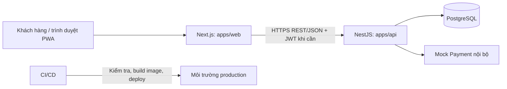
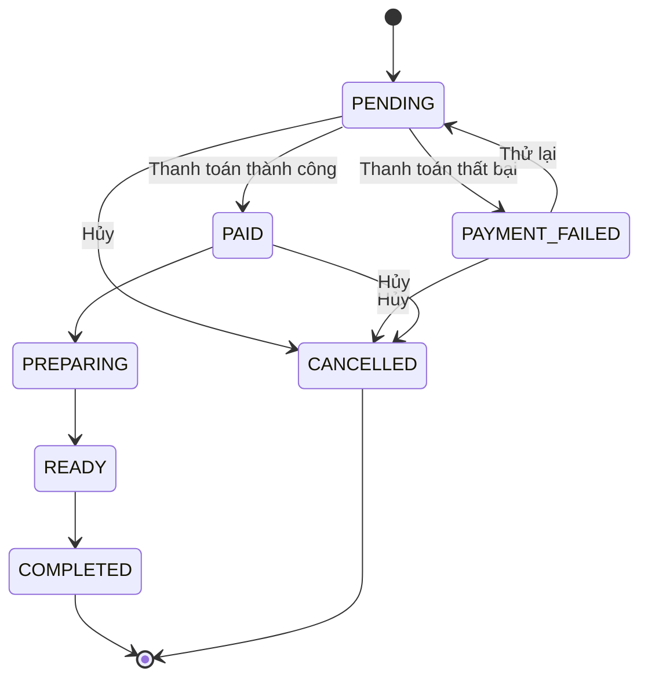

# BrewLite — Tổng quan project giữa kỳ và cuối kỳ

**Ngày lập:** 13/10/2026.  
**Trạng thái:** Người dùng đã đồng ý hướng hợp nhất và yêu cầu giữ đủ hai rubric; bộ yêu cầu cụ thể nằm trong [tài liệu chuẩn](README.md). Chưa phải báo cáo kết quả triển khai hoặc xác nhận nghiệm thu.  
**Thông tin người dùng xác nhận:** Nhóm 6 thành viên; có thể báo cáo sau 2 tuần, chậm nhất khoảng 6 tuần; ưu tiên hoàn thành sớm. Chưa có ngày nộp riêng chính thức cho từng bài.  
**Mục tiêu:** Một sản phẩm, một codebase, một bộ yêu cầu nhất quán; hai mốc báo cáo và hai checklist nghiệm thu.

## 1. Kết luận: có thể và nên làm chung

Assignment 2 ghi trực tiếp: **“Assignment 2 tiếp tục sử dụng đề tài BrewLite của Assignment 1.”** Vì vậy, có thể phát triển một project BrewLite xuyên suốt giữa kỳ và cuối kỳ, không cần viết hai ứng dụng độc lập.

- **Giữa kỳ — Assignment 1:** Chứng minh 10 task sản phẩm, nghiệp vụ backend, kiểm thử và quy trình Scrum.
- **Cuối kỳ — Assignment 2:** Dùng cùng sản phẩm, bổ sung và chứng minh chuỗi yêu cầu → mô hình → kiến trúc → hai Sprint → CI/CD → production.
- Hai bài đều chấm trên thang 10 theo rubric riêng; không cộng thành một rubric 20 điểm hay dùng một checklist thay cho cả hai.
- Một file tổng hợp này giúp nhóm thống nhất công việc; **không thay thế** các tệp bắt buộc, sơ đồ, mã nguồn, test và minh chứng thực tế mà đề yêu cầu.

### Nguồn và cách dẫn trang

Trang dưới đây là **trang vật lý trong PDF**, tính cả bìa và mục lục; số in ở chân trang lệch một trang.

| Ký hiệu | Tài liệu                                                                 | Phần làm căn cứ                                                                                                    |
| ------- | ------------------------------------------------------------------------ | ------------------------------------------------------------------------------------------------------------------ |
| A1      | [BrewLite-CongNghePhanMem.pdf](references/BrewLite-CongNghePhanMem.pdf) | Trang 3–5: Scrum, phạm vi, yêu cầu; trang 6–7: 10 task; trang 7–8: nghiệp vụ, trạng thái, DoD, bàn giao và API.    |
| A2      | [Assignment2-BrewLite.pdf](references/Assignment2-BrewLite.pdf)         | Trang 3: kế thừa A1 và thứ tự task; trang 3–7: yêu cầu từng task; trang 7–8: truy vết, cấu trúc repo và checklist. |

Những mục ghi **“đề xuất”** là quyết định của bản thiết kế này, không phải nội dung được giảng viên quy định trong PDF.

## 2. Chọn cách hợp nhất và tận dụng phần hiện có

| Phương án                                                        | Đánh đổi                                                                | Kết luận                                     |
| ---------------------------------------------------------------- | ----------------------------------------------------------------------- | -------------------------------------------- |
| Tiếp tục repo `BrewLite`, đưa tài liệu đã hòa giải vào cùng repo | Giữ scaffold, lịch sử và cách chạy; cần chuẩn hóa đường dẫn và tài liệu | **Đề xuất chọn.** Ít công việc làm lại nhất. |
| Giữ hai project độc lập                                          | Phải đồng bộ API, trạng thái, test và tài liệu hai lần; dễ lệch yêu cầu | Không phù hợp mục tiêu làm nhanh.            |
| Tạo project thứ ba từ đầu                                        | Phải dựng lại nền tảng và chuyển lịch sử/minh chứng                     | Chưa có nhu cầu đủ để làm lại.               |

### Hiện trạng đã đọc trong workspace

| Thành phần                                              | Thực tế                                                                    | Cách sử dụng                                               |
| ------------------------------------------------------- | -------------------------------------------------------------------------- | ---------------------------------------------------------- |
| `BrewLite/frontend`                                     | Scaffold Next.js và trang giới thiệu; chưa có luồng mua hàng               | Giữ làm nền frontend.                                      |
| `BrewLite/backend`                                      | Scaffold NestJS, `GET /` trả `Hello World!`, test endpoint mẫu             | Giữ làm nền backend; chưa tính là có API nghiệp vụ.        |
| Spec ngày 09/10 trong `BrewLite/docs/superpowers/specs` | Có thiết kế order, payment, stock, voucher, loyalty và phân vai 6 người    | Dùng làm tài liệu tham khảo, cập nhật phần lệch hai PDF.   |
| `brewlite-assignment2/docs/requirements`                | Có bản nháp context, SRS và checkout; chưa có code sản phẩm                | Tận dụng cấu trúc FR/NFR, acceptance criteria và use-case. |
| `brewlite-assignment2/docs/diagrams`                    | Có nguồn PlantUML; SVG hiện là bản overview Graphviz theo ghi chú của repo | Phải xuất lại UML từ nguồn và kiểm tra hình trước khi nộp. |
| Kiểm tra Python của assignment2                         | Kiểm tra cấu trúc tài liệu                                                 | Không dùng thay unit/integration/E2E của sản phẩm.         |

Đây là kết quả đọc file, không phải xác nhận build, test nghiệp vụ hoặc production đang hoạt động.

### Mâu thuẫn phải sửa khi hợp nhất

| Nội dung cũ                                                           | Chuẩn của project chung                                                       | Căn cứ                                                |
| --------------------------------------------------------------------- | ----------------------------------------------------------------------------- | ----------------------------------------------------- |
| Draft A2 ghi “độc lập hoàn toàn”, không dùng A1                       | Một project phát triển xuyên suốt                                             | A2 trang 3.                                           |
| Draft A2 ghi 3 người, 14 ngày                                         | 6 người; mục tiêu 14 ngày, tối đa khoảng 6 tuần                               | Người dùng xác nhận trong phiên này.                  |
| Draft A2 loại voucher/loyalty khỏi runtime                            | Khuyến mãi và tích điểm phải chạy được                                        | A1 Task 10 yêu cầu cả 4 nghiệp vụ, trang 7.           |
| Draft A2 dùng `PENDING_PAYMENT`, lỗi thành `CANCELLED`, thiếu `READY` | Dùng tên và các cạnh trạng thái của A1; thanh toán lỗi là `PAYMENT_FAILED`    | A1 trang 5, 7–8.                                      |
| Spec A1 cũ không cho hủy sau `PAID`                                   | Giữ cạnh `PAID → CANCELLED` trong sơ đồ A1; quy định rõ xử lý dữ liệu đi kèm  | A1 trang 8; chính sách bù dữ liệu là đề xuất ở mục 5. |
| API lịch sử của draft A2 là `/api/v1/orders`                          | Hợp đồng chung dùng `GET /orders/me`; các API cơ bản theo mục 5               | A1 trang 8; A2 không bắt buộc prefix `/api/v1`.       |
| NFR draft A2 chỉ yêu cầu ghi lại latency, xếp testability là Should   | Giữ mục tiêu API **< 500 ms với dữ liệu mẫu**; các loại test bắt buộc là Must | A1 trang 4; A2 trang 7.                               |
| Spec A1 cũ coi browser E2E và cloud CD là tùy chọn                    | Ít nhất một E2E tự động và production/CI/CD thuộc phạm vi chung               | A2 trang 7–8.                                         |
| `/docs` từng bị Git ignore | Đã bỏ quy tắc ignore; vẫn phải commit/PR để tạo lịch sử, không coi file untracked là đã xuất bản | A2 cần artifact trên repo cùng lịch sử thay đổi. |

Không chép nguyên hai bộ spec vào một thư mục rồi coi là đã hợp nhất. Phải cập nhật SRS, use-case, sơ đồ, test tài liệu và README cùng một hợp đồng. Giữ tài liệu cũ làm tham khảo có ghi trạng thái thay thế; không xóa lịch sử hoặc tạo ngày commit giả.

## 3. Phạm vi sản phẩm chung

**BrewLite:** Web đặt đồ uống và thanh toán Ví/Thẻ mô phỏng, nhận đồ tại quầy. Khách xem menu → chọn size/topping → giỏ hàng → đăng nhập → đặt đơn → thanh toán → xác nhận và theo dõi đơn.

| Nhóm chức năng                | Mức ưu tiên chung | Điều kiện đạt tối thiểu                                                                          |
| ----------------------------- | ----------------- | ------------------------------------------------------------------------------------------------ |
| Menu và chi tiết              | Must              | Tên, ảnh, giá; chọn S/M/L và topping; UI có loading/empty/error.                                 |
| Giỏ hàng                      | Must              | Thêm, sửa số lượng, xóa; tính tổng; badge số lượng; giữ giỏ qua đăng nhập và khi thanh toán lỗi. |
| Xác thực                      | Must              | Đăng ký/đăng nhập, bcrypt, JWT; đặt đơn yêu cầu đăng nhập; không xem/thanh toán đơn người khác.  |
| Đặt đơn                       | Must              | Validate dữ liệu, backend tính giá, lưu đơn `PENDING` và chi tiết; trả mã đơn.                   |
| Thanh toán mô phỏng           | Must              | Ví/Thẻ, thành công `PAID`, thất bại `PAYMENT_FAILED`; không thu tiền thật.                       |
| Xác nhận, lịch sử, trạng thái | Must              | Mã đơn, trạng thái hiện tại, lịch sử của khách; xử lý đủ state machine.                          |
| Idempotency                   | Must              | Retry cùng yêu cầu không tạo đơn/thanh toán hoặc cộng điểm lần hai.                              |
| Tồn kho                       | Must              | Transaction + optimistic locking; hai người mua phần cuối không cùng thành công.                 |
| Khuyến mãi và tích điểm       | Must              | Áp mã hợp lệ và cộng điểm sau `PAID`; có test đúng/sai và chống lặp.                             |
| Vận hành và chất lượng        | Must              | Tài liệu truy vết, test, Docker, CI/CD, HTTPS production, health, migration, rollback.           |

**Giới hạn đề xuất:** Một cửa hàng, VND, menu/khuyến mãi seed sẵn, tồn kho theo số phần của Product. Dùng UI mobile-first, có manifest/icon và hướng PWA; không đưa thanh toán offline vào phạm vi. PDF không quy định chi tiết cache/offline, nên phần nghiệm thu PWA cần mô tả rõ trong SRS.

**Chưa đưa vào phạm vi:** Cổng thanh toán thật, dữ liệu thẻ thật, giao hàng, nhiều chi nhánh, quản lý nguyên liệu theo công thức, dashboard quản trị đầy đủ, đổi điểm thành tiền, microservices. Giao diện nhân viên nằm ngoài MVP A1, nhưng **backend state machine vẫn bắt buộc**; dùng thao tác demo nội bộ có kiểm soát và test để chứng minh cập nhật trạng thái.

## 4. Kiến trúc và cấu trúc project đề xuất

Giữ **Next.js + NestJS + PostgreSQL**. Chọn Prisma cho migration/truy cập dữ liệu theo định hướng repo hiện có. NestJS tổ chức theo module trong một ứng dụng: Auth, Products, Orders, Payments, Promotions, Loyalty; Mock Payment là thành phần nội bộ. Không cần tách microservice.



Sơ đồ trên chỉ là hình tổng quan của bản đề xuất; không thay UML activity, sequence, class hoặc deployment phải nộp.

```text
BrewLite/
├── apps/
│   ├── web/                     # Chuyển từ frontend, giữ lịch sử Git
│   └── api/                     # Chuyển từ backend, chứa Prisma/migration/seed
├── docs/
│   ├── requirements/            # Context, SRS, use-case
│   ├── diagrams/                # Nguồn UML + ảnh/PDF xuất từ nguồn
│   ├── architecture/
│   │   └── adr/                 # Quyết định quan trọng và đánh đổi
│   ├── scrum/                   # Backlog, sprint backlog, daily, burndown, review/retro
│   ├── reports/                 # midterm.md và final.md
│   ├── evidence/                # Kết quả test, link PR/CI/release, log đã lọc secret
│   ├── traceability-matrix.md
│   └── deployment.md
├── tests/                       # Integration và E2E liên ứng dụng
├── .github/workflows/           # CI trên PR; CD theo nhánh/tag thống nhất
├── docker-compose.yml
├── .env.example
└── README.md
```

`apps/web`, `apps/api`, `docs` theo A2 trang 6, 8; thư mục báo cáo, Scrum và evidence là đề xuất để tổ chức minh chứng. A1 cho phép monorepo nên có thể dùng cấu trúc chung này và giải thích web = frontend, api = backend trong README.

**Khi chuyển thư mục:** Cập nhật đồng thời lệnh npm trong README, working directory của CI, Docker build context, env mẫu và các tham chiếu đường dẫn. Không chỉ đổi tên thư mục. Giữ các công cụ/test/lockfile đã dùng; chưa cần bổ sung hệ thống quản lý monorepo.

**Production:** Chọn một nền tảng thực tế tại Task 3 sau khi kiểm tra quyền truy cập, chi phí và khả năng deploy image. Chưa coi các nhà cung cấp ghi trong draft cũ là lựa chọn đã xác nhận. Deployment diagram phải thể hiện web/CDN, API, PostgreSQL có persistent storage, registry/nền tảng, HTTPS/cổng nội bộ, secrets, log, health và ranh giới local/CI/production. PostgreSQL production không mở trực tiếp ra Internet.

## 5. Hợp đồng nghiệp vụ cần dùng thống nhất

### API và dữ liệu

- Giữ API tối thiểu: `GET /products`, `GET /products/:id`, `POST /auth/register`, `POST /auth/login`, `POST /orders`, `POST /payments`, `GET /orders/me`.
- Đề xuất thêm `GET /orders/:id` để theo dõi chi tiết và `GET /health` cho vận hành; đọc đơn yêu cầu JWT và quyền sở hữu.
- Không tin `userId`, giá, tổng tiền hoặc kết quả thanh toán do client tự khai. Backend lấy user từ JWT, kiểm tra size/topping/số lượng, tính giá và lưu snapshot của đơn.
- VND dùng số nguyên. Khuyến mãi đơn giản: một mã giảm số tiền cố định cho mỗi đơn; kiểm tra hiệu lực và điều kiện áp dụng. Công thức điểm đề xuất: `floor(số tiền thực trả / 10000)`; đây là lựa chọn nhóm, không phải công thức của PDF.
- Class diagram tối thiểu gồm **User, Product, Order, OrderItem, Payment, Promotion, LoyaltyTransaction**, có thuộc tính, quan hệ, multiplicity và enum. Nếu kế thừa tên Voucher từ spec cũ, chuẩn hóa rõ quan hệ tên đó với Promotion; không tạo hai hệ khuyến mãi trùng nhau.

### Trạng thái đơn hàng

Các cạnh sau theo sơ đồ A1 trang 8:



Mọi cạnh không liệt kê bị chặn. Retry thất bại phải đi qua `PAYMENT_FAILED → PENDING`, không nhảy thẳng sang `PAID`. Không bỏ `READY`, không đổi lỗi thanh toán thành hủy đơn. Thao tác hủy đơn đã trả tiền chỉ hợp lệ khi còn `PAID`, chưa sang `PREPARING`.

**Chính sách dữ liệu đề xuất, PDF chưa quy định:** Khi tạo đơn, giữ kho bằng transaction; lỗi thanh toán/hủy đơn thì trả kho đúng một lần. Retry cùng đơn phải kiểm tra và giữ lại đủ kho trước khi thanh toán. Với `PAID → CANCELLED`, thao tác nội bộ ghi nhận hoàn thanh toán mô phỏng, trả kho và bù số điểm đã cộng đúng một lần, giữ lịch sử giao dịch. Không xóa Payment/LoyaltyTransaction để che giao dịch cũ; không có hoàn tiền qua ngân hàng thật. Test phải chứng minh hủy lặp không hoàn kho hoặc trừ điểm lặp.

Hết hạn 15 phút và tự chuyển trạng thái sau 10/30 giây là quyết định trong tài liệu cũ, **không phải yêu cầu PDF**. Không lấy các cơ chế đó làm điều kiện bắt buộc của bản 14 ngày; tập trung hoàn thành state machine, retry và kiểm thử trước.

### Chống lặp và tranh chấp dữ liệu

- `POST /payments` dùng `Idempotency-Key`. Retry do timeout dùng lại key và `orderId`; cùng yêu cầu trả kết quả cũ, không gọi xử lý thanh toán lần hai.
- Đề xuất áp dụng key riêng cho `POST /orders` để chặn double-click tạo hai đơn. Cùng key khác payload bị từ chối; cố ý thử thanh toán lại sau một kết quả thất bại dùng key mới trên cùng đơn.
- Ràng buộc unique ở database bảo vệ xử lý đồng thời; không chỉ dùng biến nhớ trong tiến trình API. Một đơn chỉ được ghi nhận thanh toán thành công và cộng điểm một lần, kể cả gửi hai key khác nhau.
- Product có `stock` và `version`; cập nhật có điều kiện dựa trên version và số lượng còn lại trong transaction. Thiếu kho/xung đột phải rollback, không để đơn hoặc kho cập nhật dở dang.
- Mock Payment có kịch bản thành công/thất bại xác định để test/demo; client không được gửi cờ thành công đáng tin cậy. Không giữ transaction trong lúc chờ thao tác người dùng.

## 6. Đối chiếu toàn bộ rubric giữa kỳ — Assignment 1

Mỗi dòng dưới là **1 điểm**, chưa đánh dấu đạt nếu chưa có bằng chứng chạy và review.

| Task  | Phải hoàn thành trong project chung                                                          | Liên hệ với A2                                 | Minh chứng giữa kỳ                                                                                 |
| ----- | -------------------------------------------------------------------------------------------- | ---------------------------------------------- | -------------------------------------------------------------------------------------------------- |
| A1-01 | Next.js/NestJS, cấu trúc repo, chạy được, Git, README, env mẫu                               | Task 4.1                                       | Clone/chạy theo README, commit và review.                                                          |
| A1-02 | `GET /products` trả menu có id/tên/giá/ảnh                                                   | Task 4.3                                       | API test và dữ liệu mẫu/seed.                                                                      |
| A1-03 | Menu gọi API, render sản phẩm, loading/empty                                                 | Task 4.3                                       | UI chạy thật, thêm error state theo A2.                                                            |
| A1-04 | Chi tiết, size S/M/L, topping, tính giá                                                      | Task 4.3 có API detail; Task 5.1 hoàn thiện UI | Demo lựa chọn và kiểm tra giá.                                                                     |
| A1-05 | Giỏ thêm/sửa/xóa, tổng tiền, badge                                                           | Task 5.1                                       | Kiểm tra giỏ và giữ dữ liệu qua login.                                                             |
| A1-06 | `POST /orders`, class-validator, lưu `PENDING`, mã đơn                                       | Task 5.1–5.2                                   | Integration test tạo đơn, dữ liệu sai bị chặn.                                                     |
| A1-07 | Register/login, bcrypt, JWT guard đặt đơn                                                    | Task 5.1                                       | Test auth, token sai/hết hạn và ownership.                                                         |
| A1-08 | Ví/Thẻ mock; `PAID` hoặc `PAYMENT_FAILED`                                                    | Task 5.1–5.2                                   | Demo cả thành công/thất bại, giữ giỏ khi lỗi.                                                      |
| A1-09 | Xác nhận, `GET /orders/me`, Compose 3 dịch vụ, README, demo E2E                              | Task 5.2–5.4                                   | Demo trọn luồng, lịch sử và cách chạy local.                                                       |
| A1-10 | **Cả 4:** state machine; idempotency; transaction + optimistic locking; khuyến mãi + loyalty | Task 1–3 đặc tả/mô hình; Task 5 hiện thực/test | Test chặn chuyển sai; cùng key chỉ một đơn/thanh toán; không oversell; mã hợp lệ và điểm sau PAID. |

Ngoài bảng task: giữ mục tiêu API **< 500 ms với dữ liệu mẫu**, password hash/JWT/validation, sử dụng trên trình duyệt, DoD và minh chứng Scrum (A1 trang 3–5, 8). Đề xuất đo trên môi trường nghiệm thu ghi rõ cấu hình/dataset và lưu kết quả; không tự bỏ mục tiêu do sử dụng hosting có cold start.

## 7. Đối chiếu toàn bộ rubric cuối kỳ — Assignment 2

Mỗi task lớn là **2 điểm**. Thứ tự nghiệm thu bắt buộc: **Task 1 → Task 2 → Task 3 → Task 4 → Task 5**. Có thể chia người làm các phần độc lập trong task đang mở; chỉ nghiệm thu task tiếp theo khi tạo phẩm bắt buộc task trước có trên repo và có lịch sử thay đổi rõ.

| Task   | Tạo phẩm cần có                                              | Điều kiện nghiệm thu                                                                                                                                                            |
| ------ | ------------------------------------------------------------ | ------------------------------------------------------------------------------------------------------------------------------------------------------------------------------- |
| A2-1.1 | `docs/requirements/context-and-scope.md`                     | Vấn đề, đủ stakeholder và kỳ vọng, in/out scope, giả định, ràng buộc, rủi ro.                                                                                                   |
| A2-1.2 | SRS và use-case tổng quát                                    | FR/NFR có mã, MoSCoW, acceptance criteria kiểm chứng cho từng yêu cầu; đủ nghiệp vụ cùng NFR về hiệu năng, bảo mật, tính khả dụng và khả năng triển khai.                       |
| A2-1.3 | `use-case-checkout.md` và diagram cho checkout               | Actor, trigger, pre/postcondition, luồng chính/thay thế/ngoại lệ; liên kết mã yêu cầu.                                                                                          |
| A2-2.1 | Activity diagram                                             | Start/end, user/system, decision/merge, swimlane khi cần; đủ chưa login, hết hàng, payment fail.                                                                                |
| A2-2.2 | Sequence diagram checkout                                    | Customer → UI → API → DB → Payment Service; JWT/validate, transaction/kho, success/failure, retry idempotent, kết quả cho khách.                                                |
| A2-2.3 | Class diagram                                                | Đủ 7 lớp bắt buộc ở mục 5, thuộc tính/quan hệ/multiplicity/enum; không mâu thuẫn SRS và hai sơ đồ trên.                                                                         |
| A2-3.1 | Mô tả C4 hoặc kiến trúc phân lớp và `docs/architecture/adr/` | Next.js/PWA, NestJS module, PostgreSQL/migration, mock, logging/health/config; lý do, ưu/nhược điểm và đánh đổi.                                                                |
| A2-3.2 | UML deployment diagram                                       | Đúng nền tảng thực tế và đầy đủ thành phần/kết nối ở mục 4; truy được mỗi dịch vụ về code/kiến trúc.                                                                            |
| A2-4.1 | Repo `apps/web`, `apps/api`, `docs`, README/gitignore/env    | Branch/PR, issue board cho 2 Sprint, commit convention, DoD và quyền truy cập.                                                                                                  |
| A2-4.2 | Toàn bộ tài liệu Task 1–3 trong Git                          | Thay đổi qua commit/PR, nêu lý do; file chỉ nằm trên máy hoặc bị ignore chưa đạt.                                                                                               |
| A2-4.3 | MVP Sprint 1 chạy được                                       | API list/detail, menu mobile-first, loading/empty/error, seed, test API và component/luồng chính.                                                                               |
| A2-4.4 | CI trên PR: install → lint → unit test → build               | Required checks thực sự chặn merge khi lỗi; có link PR, một lần CI xanh và một lần phát hiện lỗi.                                                                               |
| A2-5.1 | MVP checkout hoàn chỉnh                                      | Detail/size/topping, cart, JWT, order, mock payment, xác nhận/trạng thái/lịch sử; validate và lỗi cả FE/BE.                                                                     |
| A2-5.2 | Unit + integration + ít nhất 1 E2E menu → confirmation       | Nghiệp vụ quan trọng có test; API order/payment có integration; migration/seed tái tạo DB, Compose web/API/DB và health endpoint.                                               |
| A2-5.3 | Pipeline CD                                                  | Quality gate; build Docker image tag SHA/semver; push registry nếu nền tảng yêu cầu; deploy bằng CI secrets; migration an toàn; smoke/health; dừng khi lỗi và có cách rollback. |
| A2-5.4 | Bản production và bàn giao                                   | Frontend HTTPS, URL API/health, DB không public trực tiếp, không lộ secret; release/tag/notes; README local/test/build/deploy/rollback; video hoặc demo, Review và Retro.       |

**Nguồn sơ đồ và bản kết xuất:** Lưu cả `.puml` và `.svg`/PDF đã render, kiểm tra bằng mắt. Dùng quy ước này cho toàn bộ UML để dễ kiểm soát phiên bản; đề nêu rõ yêu cầu lưu nguồn + bản kết xuất ở phần sequence.

**Truy vết bắt buộc:** `docs/traceability-matrix.md` phải nối mã yêu cầu → use-case/story → thiết kế/sơ đồ → code/API → test. Khi kế thừa SRS, giữ mã hiện có cho cùng nghĩa, ghi thay đổi/bổ sung trong lịch sử; không đổi hàng loạt FR ID mà không cập nhật các tài liệu liên quan.

Ví dụ một dòng dự kiến: yêu cầu thanh toán → UC checkout → sequence-checkout → `POST /payments` → integration success/failure/replay. Đường dẫn code/test chỉ được ghi là đã có sau khi tạo và kiểm chứng; kế hoạch không phải bằng chứng hoàn thành.

**Hai điều kiện dễ mất điểm:** Thiếu tạo phẩm task trước thì task sau không được tính điểm phần truy vết; không có URL production hoạt động khi chấm thì phần triển khai Task 5 chưa hoàn thành (A2 trang 8).

## 8. Kế hoạch tăng tốc cho 6 người

### Mục tiêu 14 ngày

Nếu bắt đầu từ 13/10/2026, mốc khoảng hai tuần là **27/10/2026**, sáu tuần là **24/11/2026**. Đây là mốc tính tương đối để lập kế hoạch, không phải lịch nộp đã được giảng viên công bố. D1 là ngày nhóm thực sự bắt đầu.

| Khoảng           | Công việc và đầu ra                                                                  | Cổng chuyển tiếp                                               |
| ---------------- | ------------------------------------------------------------------------------------ | -------------------------------------------------------------- |
| D1               | Hòa giải tài liệu cũ; hoàn tất context, SRS, use-case; thống nhất phạm vi cả hai bài | Task 1 có file trong repo, review và commit/PR rõ.             |
| D2               | Activity, sequence, class; review state/stock/payment/voucher/loyalty                | Task 2 nhất quán với Task 1, nguồn và hình kết xuất đủ.        |
| D3               | Kiến trúc, ADR, chọn môi trường triển khai có thể sử dụng, deployment diagram        | Task 3 có đủ artifact; mới mở nghiệm thu triển khai.           |
| D4–D6 — Sprint 1 | Chuẩn hóa repo, PostgreSQL/seed, API list/detail, menu, test, CI và rule chặn merge  | Task 4: menu chạy thật; CI green/red; Sprint Review/Retro.     |
| D7–D9 — Sprint 2 | Chi tiết/tùy chọn, giỏ, JWT, tạo đơn, tính giá và kho đồng thời                      | Luồng từ menu đến đơn `PENDING`; tích hợp FE/BE mỗi ngày.      |
| D10–D11          | Payment mock, retry/idempotency, promotion/loyalty, history và state machine         | Demo happy path và lỗi; đủ nghiệp vụ A1-10.                    |
| D12              | Unit/integration/E2E, kiểm tra concurrency/giá/quyền truy cập, Compose, hiệu năng    | Rà đủ 10 task A1; đóng lỗi cản demo trước khi tạo mốc giữa kỳ. |
| D13              | CD, migration an toàn, production HTTPS, health/smoke, thử quy trình rollback        | Bản triển khai truy cập được; log và release notes thật.       |
| D14              | Kiểm tra từ máy khác, cập nhật traceability, hai báo cáo, video/demo, Review/Retro   | Rà checklist A1/A2 riêng; ghi rõ hạng mục chưa đạt.            |

Đây là mục tiêu tăng tốc khá chặt vì code hiện mới ở scaffold. QA viết test cases từ D1; tích hợp, Docker và chuẩn bị CD bắt đầu trong Sprint 1, không dồn toàn bộ đến D12–D13. Nếu một cổng chưa đạt, cập nhật kế hoạch thực tế; không ghi nghiệm thu giả để giữ lịch.

### Phần dự phòng đến 6 tuần

| Khoảng   | Ưu tiên nếu chưa hoàn tất trong 14 ngày                                                            |
| -------- | -------------------------------------------------------------------------------------------------- |
| Tuần 3–4 | Hoàn tất phần bắt buộc còn thiếu; sửa lỗi stock/payment/state; bổ sung test và production ổn định. |
| Tuần 5   | Hoàn thiện truy vết, UML đúng code, kiểm tra hiệu năng, migration/rollback và demo trên máy khác.  |
| Tuần 6   | Chốt release, luyện trình bày, rà quyền truy cập và URL đúng ngày chấm; không thêm chức năng mới.  |

Không dùng khoảng dự phòng để bỏ A1 Task 10 hoặc thay E2E/production bằng mô tả. Nếu phải báo cáo ở tuần 2 mà chưa hoàn thành, báo cáo đúng tiến độ và phần còn thiếu; không coi scaffold hoặc tài liệu là sản phẩm đã xong.

### Phân công 6 người

Xem [bảng phân công và cách phối hợp](team-assignments.md). Đây là nơi cập nhật trách nhiệm từng thành viên; không duy trì bảng phân công trùng trong tổng quan.

Scrum gồm Planning, Daily ngắn, Review và Retrospective cho từng Sprint; cập nhật điểm còn lại cuối mỗi ngày và vẽ burndown từ dữ liệu thật. A1 gợi ý ba Sprint nhưng không bắt buộc; bản chung giữ **hai Sprint triển khai** của A2. Backlog/story points không đồng nhất với điểm chấm bài.

## 9. Hai báo cáo từ một project

|                       | Báo cáo giữa kỳ                                                                      | Báo cáo cuối kỳ                                                                      |
| --------------------- | ------------------------------------------------------------------------------------ | ------------------------------------------------------------------------------------ |
| Tệp đề xuất           | `docs/reports/midterm.md`                                                            | `docs/reports/final.md`                                                              |
| Trọng tâm             | Đối chiếu 10 task A1, sản phẩm và nghiệp vụ, Scrum, demo local                       | Chuỗi 5 task A2, UML/ADR/truy vết, hai Sprint, test/CI/CD, production                |
| Minh chứng            | Commit/PR, test Task 10, Compose, happy path và payment fail, backlog/burndown/retro | Tạo phẩm từng cổng, CI xanh/đỏ, E2E, image/tag/release, URLs, smoke/rollback và demo |
| Mốc phiên bản đề xuất | Tag `midterm-v1` tại commit thực sự đáp ứng A1                                       | Tag `final-v1` tại commit thực sự đáp ứng A2                                         |

Hai báo cáo dẫn đến cùng mã nguồn và tài liệu chuẩn, nhưng chỉ rõ snapshot được đánh giá và tiến bộ giữa hai lần. Nếu giữa kỳ đã làm được CI/CD hoặc tài liệu A2, ghi là phần hoàn thành sớm; không cần làm lại để giả tạo giai đoạn cuối kỳ. Nếu code A1 đã có trước tài liệu A2, ghi nhận đó là baseline kế thừa, rồi tạo/review tài liệu A2 theo đúng thứ tự trước khi nghiệm thu các task sau.

## 10. Checklist hoàn tất và bước kế tiếp

- [ ] Một SRS chung, không còn hai hợp đồng trạng thái/API/khuyến mãi mâu thuẫn.
- [ ] Đủ 10 task A1; đặc biệt cả 4 nghiệp vụ Task 10 và test chứng minh.
- [ ] Đủ artifact Task 1–3 A2, nguồn/hình UML, ADR, Git history và review.
- [ ] Task 4 A2 có MVP thật, CI tự động và chặn merge; bằng chứng CI green/red.
- [ ] Task 5 A2 có unit/integration/E2E, Compose, migration/seed, health, CD và rollback.
- [ ] API đạt mục tiêu thời gian phản hồi với dữ liệu mẫu, có ghi môi trường đo.
- [ ] Frontend HTTPS/API/health truy cập được khi chấm; DB/secret được bảo vệ.
- [ ] Traceability trỏ đến file, API và test có thật; không ghi kết quả chưa chạy.
- [ ] Repo/PR/release và quyền truy cập giảng viên sẵn sàng; README đủ để người ngoài chạy.
- [ ] Hai báo cáo, demo/video, Scrum Review/Retro và backlog phản hồi hoàn chỉnh.

**Áp dụng Superpowers:** Bản này là đầu ra phân tích và thiết kế chung của Brainstorming. Khi chuyển sang triển khai, dùng bản thiết kế đã thống nhất để lập implementation plan bằng Writing Plans; plan phải chỉ rõ file/caller/config/test bị ảnh hưởng. Sau đó triển khai từng phần nhỏ, review và Verification Before Completion dựa trên kết quả thực tế. Không coi việc tạo tài liệu là đã hợp nhất ứng dụng hoặc đã hoàn thành các task chấm điểm.

**Cập nhật sau khi người dùng đồng ý hợp nhất:** Đã tạo bộ context/SRS/use-case/test cases/traceability trong repo chính, thêm nguồn UML, đánh dấu spec cũ là lịch sử và bỏ Git ignore toàn bộ `docs`. Hai PDF nguồn đã được sao chép nguyên vẹn vào `docs/references`. Trạng thái render UML ghi trong [mục lục sơ đồ](diagrams/README.md); không coi nguồn UML là bằng chứng đã có hình kết xuất.

**Giới hạn hiện tại:** Chưa chuyển thư mục code, viết chức năng, chạy test ứng dụng, commit/push, tạo PR hoặc deploy. Tài liệu mới cần review nhóm và Git history thực để nghiệm thu. Chưa xác minh điều kiện/giá hosting; nền tảng production phải được kiểm tra ở Task 3. Các mục đề xuất kỹ thuật ngoài PDF vẫn là quyết định nhóm, không phải yêu cầu bổ sung do giảng viên đưa ra.

## 11. Rà soát tài liệu ngày 15/10/2026

Đã bổ sung [kiến trúc phân lớp và ADR](architecture/README.md), [chuẩn bị triển khai/bàn giao](deployment.md) và nguồn UML còn thiếu. [SRS 2.1](requirements/srs.md) làm rõ class-validator cho tạo đơn; [auth contract](auth-contract.md) giữ TTL/cách lưu token là quyết định mở, 3600 chỉ là ví dụ. Hosting, hình render, review/Git history, code, test và production vẫn cần hoàn tất. Xem [bảng trạng thái từng cổng](README.md) trước khi báo cáo tiến độ.
