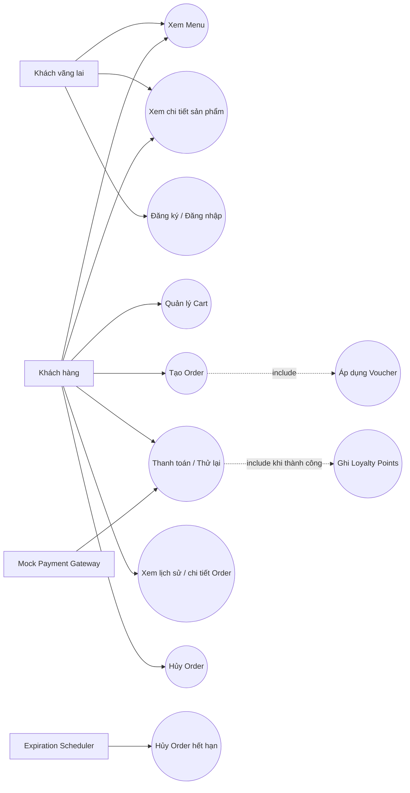
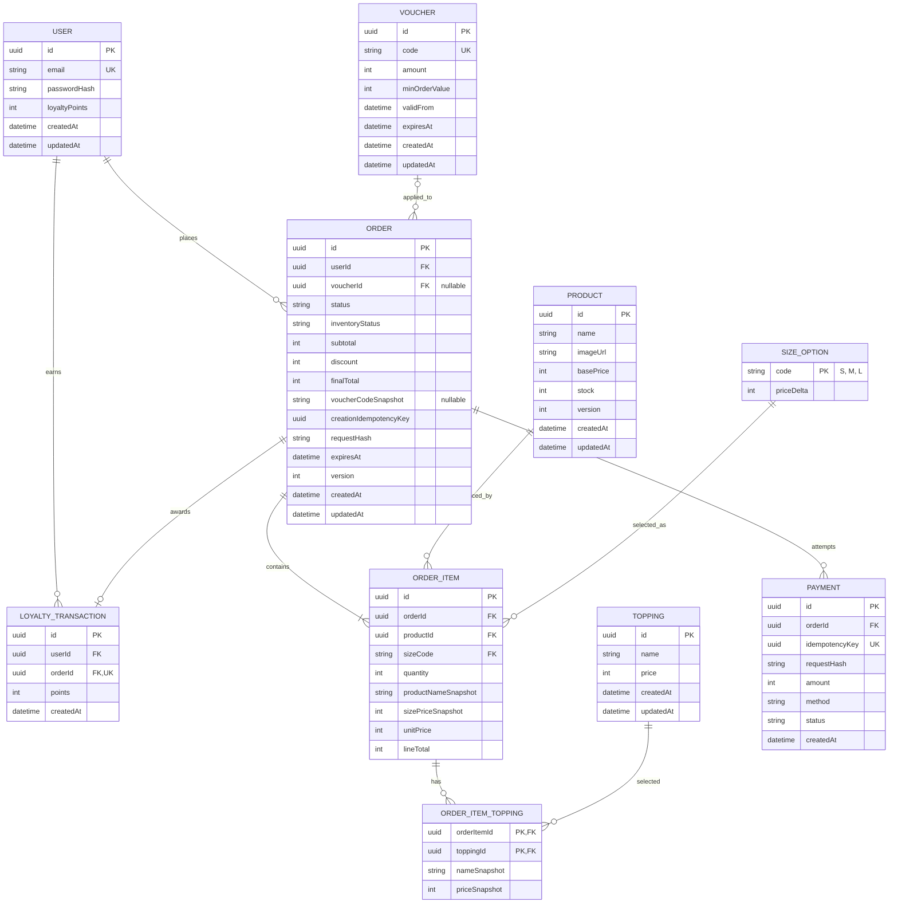
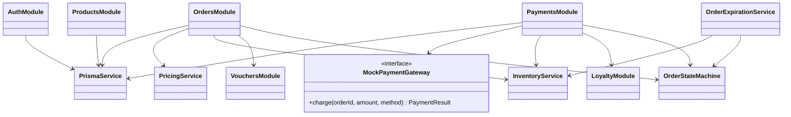
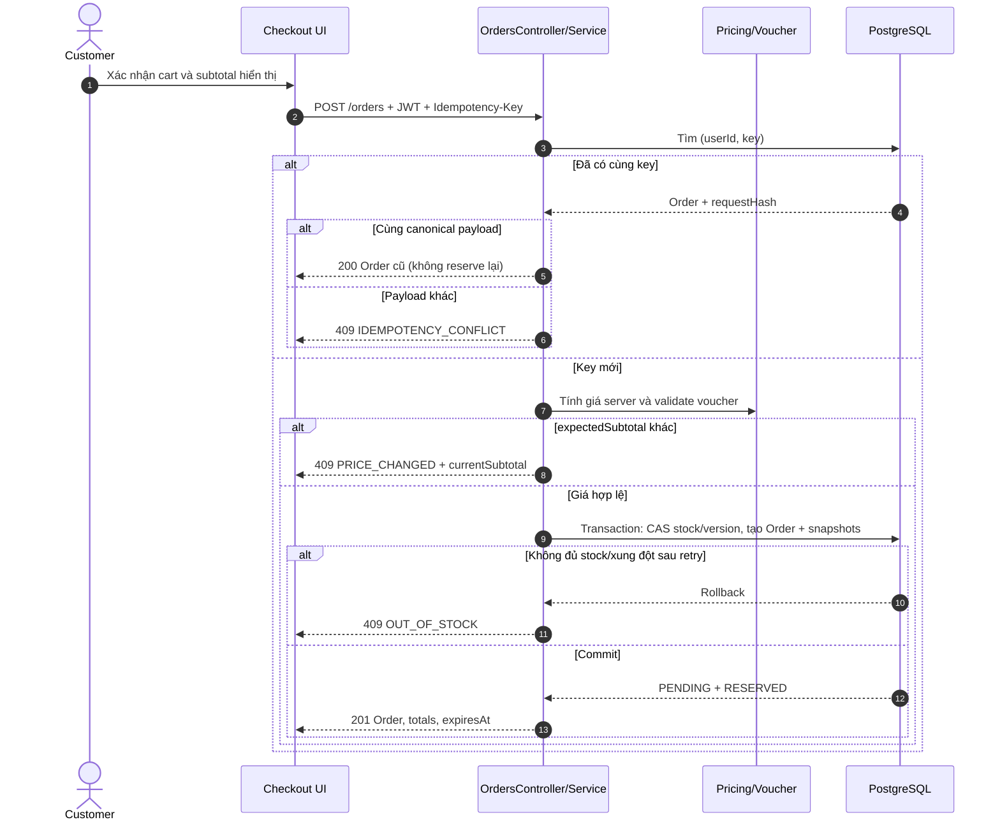
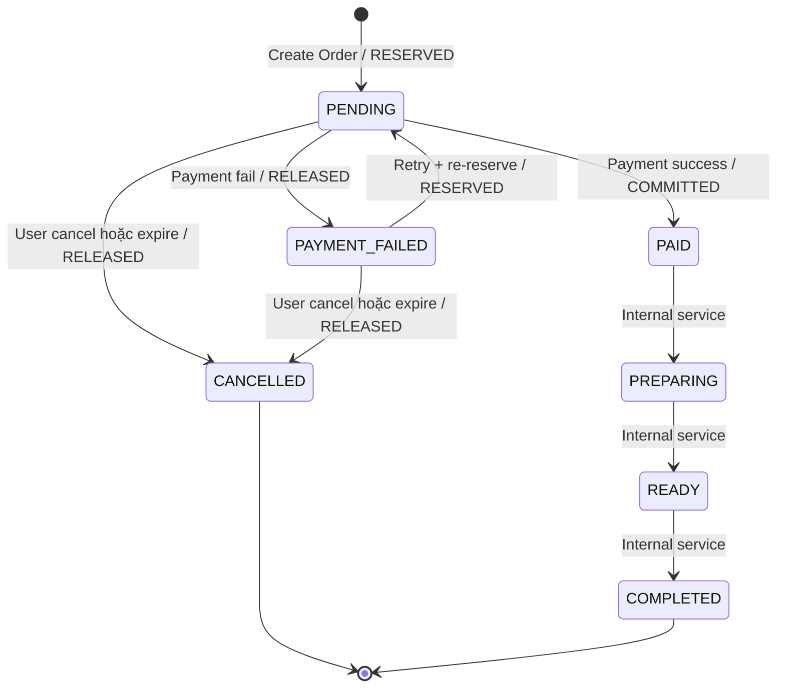

# BrewLite — UML và ERD

**Owner:** Đức Phúc (TV6)  
**Baseline:** 10 bảng, REST contract v1 và state machine trong architectural design specification.

Các sơ đồ dưới đây dùng Mermaid để có thể review trực tiếp trên GitHub và cập nhật cùng source code.

## 1. Use case diagram



## 2. ERD — đúng 10 bảng



### Ràng buộc dữ liệu bắt buộc

- Unique: `User.email`, `Voucher.code`, `(Order.userId, Order.creationIdempotencyKey)`, `Payment.idempotencyKey`, `LoyaltyTransaction.orderId`.
- Check: stock/points không âm; quantity và amount hợp lệ; `finalTotal = subtotal - discount > 0`.
- Partial unique index: tối đa một Payment `PROCESSING` và một Payment `SUCCEEDED` cho mỗi Order.
- Không cascade-delete dữ liệu lịch sử. `isAvailable` chỉ là giá trị tính từ `Product.stock > 0`.

## 3. Class/module diagram



## 4. Sequence — tạo Order



## 5. Sequence — payment fail/retry/success

```mermaid
sequenceDiagram
    autonumber
    actor C as Customer
    participant UI as Payment UI
    participant PS as PaymentService
    participant GW as MockPaymentGateway
    participant DB as PostgreSQL

    C->>UI: Chọn WALLET hoặc CARD
    UI->>PS: POST /payments + JWT + unique key
    PS->>DB: Kiểm tra owner rồi tìm payment key
    alt Replay cùng key/payload
        DB-->>PS: Payment terminal đã lưu
        PS-->>UI: 200 kết quả cũ
    else Attempt mới hợp lệ
        PS->>GW: charge(orderId, amount, method)
        GW-->>PS: SUCCESS hoặc FAIL quyết định
        PS->>DB: Transaction + kiểm tra expiry/version/state
        alt Retry từ PAYMENT_FAILED
            DB->>DB: Re-reserve stock nếu còn
        end
        alt SUCCESS trước expiresAt
            DB->>DB: Payment SUCCEEDED; Order PAID/COMMITTED
            DB->>DB: LoyaltyTransaction unique + cộng điểm
            DB-->>PS: Commit
            PS-->>UI: 200 success; xóa Cart
        else FAIL
            DB->>DB: Payment FAILED; Order PAYMENT_FAILED/RELEASED
            DB->>DB: Hoàn stock đúng một lần
            DB-->>PS: Commit
            PS-->>UI: 200 business failure; cho phép retry
        else Hết hạn/xung đột
            DB-->>PS: Rollback
            PS-->>UI: 409 error code phù hợp
        end
    end
```

## 6. Order state machine



### Invariant của state machine

- `CANCELLED` và `COMPLETED` là terminal; không có public endpoint đổi trạng thái hậu thanh toán.
- Stock chỉ được hoàn khi `inventoryStatus = RESERVED`; không hoàn lần hai.
- Order ở hoặc sau `PAID` không bị scheduler hủy.
- Payment tại hoặc sau `expiresAt` bị từ chối dù scheduler chưa kịp cập nhật Order.

## 7. Điểm review chéo

- Tấn Nin: xác nhận schema, Order/Inventory transaction và FSM.
- Quốc Anh: xác nhận Auth, Payment/Voucher/Loyalty contract và sequence payment.
- Anh Khoa: review phạm vi, conventions và quyết định tích hợp.
